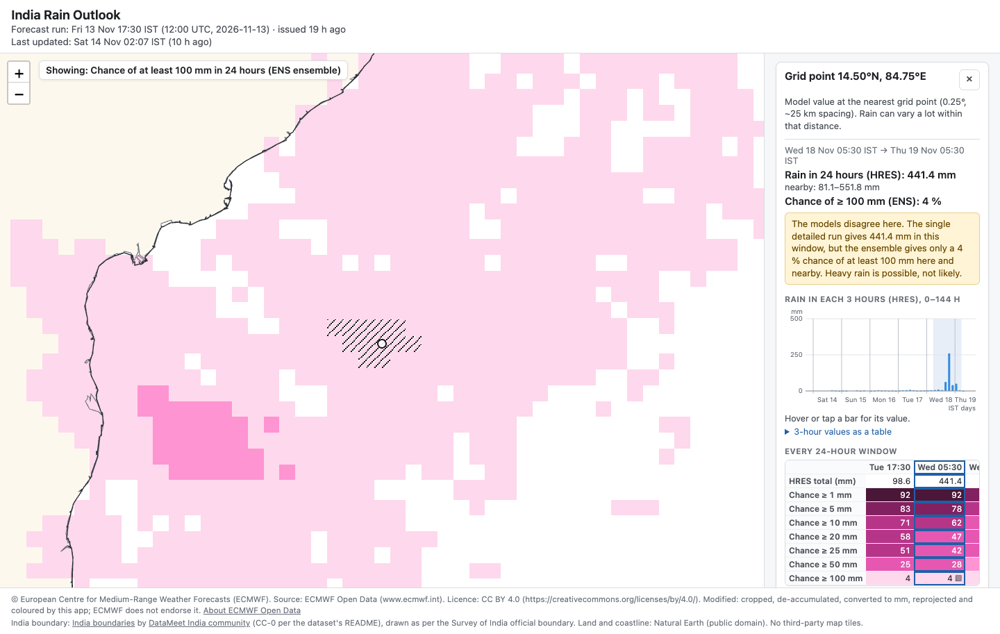
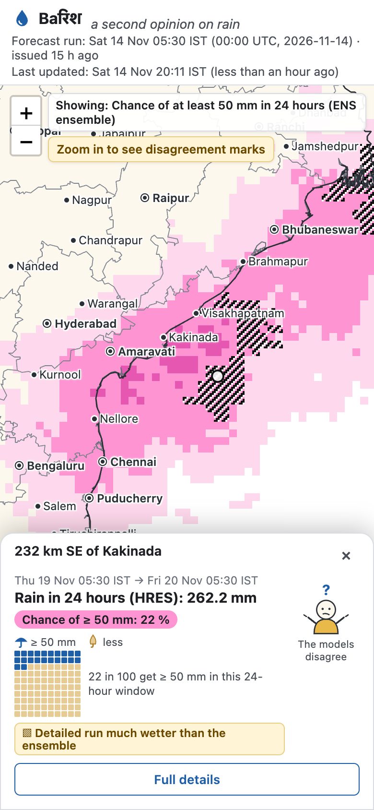

# Baरिश (Barish): a second opinion on rain

Rain forecasts for India and nearby seas that put ECMWF's **single high-resolution run (HRES)** next to its **ensemble
(ENS)**, so you can see not only how much rain one run predicts but also how likely it is. The site is refreshed after every
00z and 12z run.

**Live:** https://shuvbytes.github.io/quest-precip/ · **API:** https://quest-precip-api.onrender.com/docs ·
Status: complete for the task; two extra features are planned (see the end).

<p>
  
  
</p>

*Left (run 13 Nov 12z): at 14.50°N 84.75°E the single run gives **441 mm** in 24 h, but the ensemble gives only a **4 %**
chance of ≥ 100 mm, so the map hatches it as "much wetter than the ensemble" ([caption](docs/readme/bay_disagreement.md)).
Right (run 14 Nov 00z, phone): the point card for a similar case, with 262 mm against a 22 % chance of ≥ 50 mm.*

## What you can do
- See **3-hour or 24-hour rain** from the single run, or the **ensemble's chance** of ≥ 1–100 mm. Hatching marks where the two
  disagree. Use the time slider or **▶ play**, and **swipe** to compare both side by side.
- **Tap a point** to open the card (the amount, the chance and its "**100 skies**" picture, where the place is, a small guide character) and the panel
  (3-hourly chart, every 24 h window, ensemble table).
- **Find a place** (old names work too: Madras → Chennai). Arrow keys move one grid point at a time, so the whole map is usable from the keyboard.
- It works on phones in portrait and landscape, and every view is a shareable link.

## Data and honesty choices
- **Data:** ECMWF Open Data, IFS 0.25°: HRES total precipitation 0–144 h and ENS probabilities (24 h windows). Units come from
  the GRIB files (m → mm). Times are handled in UTC and shown in IST with exact window bounds ("Sat 05:30 IST → Sun 05:30 IST").
- **No colour for noise:** each frame's lowest colour sits above the data's storage precision (2 × the GRIB packing step). If a
  run is stored more coarsely, the map says so. A value is the model **at the nearest grid point**, not an area average.
- **Disagreement rule:** the run gives ≥ X mm but the ensemble's chance is < 25 % here and at all neighbouring points (or the reverse with ≥ 75 %).
  Only groups of ≥ 3 points are marked on the map, and the wording never calls either model wrong.
- Chances read "**in 100**", never "members", because the data file does not state the ensemble size. The colours were checked
  for contrast and colour blindness. The map uses India's official boundary, and every source is cited on the page.

## How it works
```
GitHub Actions (hourly slots after each ECMWF run) ─ download ─ tests ─ build ─► GitHub Pages (map, manifest.json, points.bin)
                                                                              └► Render FastAPI /point (same files, refreshed on deploy)
```
- A failed download, test or build stops before deploying, so the last good site stays live. The page shows "last updated"
  and flags an old run.
- The page asks the API first (3 s timeout) and otherwise reads `points.bin` (≈ 0.6 MB gzip) itself. The panel says which one answered.
- `GET /point?lat=13.08&lon=80.27` → nearest grid point, "Near Chennai (11 km)", every 3 h and 24 h amount, every chance,
  disagreement flags, all in the panel's wording. Bad input gets a plain 422, outside the area a 404. Only the site may call it from a browser.

## Validation and how it was built
- Peaks checked against **ECMWF's own charts** for the same runs ([docs/validation](docs/validation)): a 505 mm 6-day total and a
  260 mm 3-hour burst both match their location and intensity class.
- **80 tests** (de-accumulation, packing, windows, palette, build, API). A mutation check proves the floor tests catch a wrong floor.
  The panel, Python and API agree on **700/700** fields. A keyboard walk over all **18,753** grid points passes, and so do layout
  checks on 5 screen sizes, in real headless Chrome. Safari and an Android phone were checked by hand.
- **Built with Claude Code in one session**, which started on **Thu 12 Nov 2026, 16:22 IST** (first commit). I set the goals
  and made every decision, and Claude Code wrote the code and checks in small, tested, committed steps (100+ commits).
  [CLAUDE.md](CLAUDE.md) is the running record of goals, decisions, measurements and bugs found.

## Run locally
```bash
conda env create -f environment-dev.yml && conda activate quest-precip
python pipeline/fetch.py                                   # newest 00z/12z run into data/raw/
python pipeline/build.py data/raw/hres_tp_<run>.grib2 data/raw/ens_tpg_<run>.grib2
python3 -m http.server 8000 --directory site_build         # http://localhost:8000
python -m pytest                                           # tests; dev checks: pipeline/m6_check.py, pipeline/m8_checks.py
```

## Limits and next steps
- Values are 0.25° grid points (~25 km apart), and rain varies within that distance. The ensemble's 24 h windows don't match calendar days.
  GitHub's scheduled runs can start hours late. The free API sleeps after 15 minutes, which costs about 30 s on the first request.
- Next: **plan my day** (driest stretch of a chosen day), **story mode** (a guided tour of the run's most interesting spots),
  vector hatching (the raster stripes look stepped at maximum zoom), and an IMD rain-day (08:30–08:30 IST) view.

## Credits
Forecast data © ECMWF, [CC BY 4.0](https://creativecommons.org/licenses/by/4.0/) (modified: cropped, de-accumulated,
converted to mm, reprojected, coloured; ECMWF does not endorse this app). India boundary: DataMeet (CC-0 per its README).
State boundaries: DataMeet (CC BY 4.0). Land, coastline, places: Natural Earth (public domain). Map library: Leaflet (BSD-2).
Built for the QUEST Lab pre-doctoral task.
