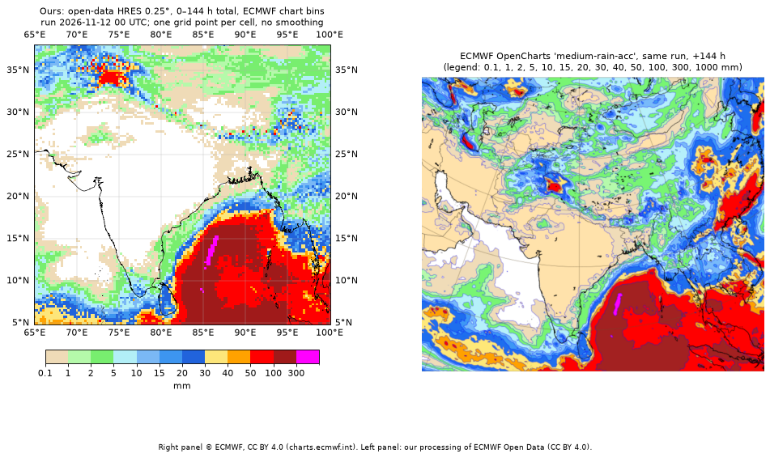

# Validation: run 2026-11-12 00 UTC vs ECMWF's own chart and the 0.1° field

**Question.** Does our processing of ECMWF Open Data (IFS HRES `tp`, 0.25°) reproduce ECMWF's published
chart for the same run? Where the two maps differ, is it a bug?

**Answer.** Yes, it reproduces the chart. The three visible differences come from (1) the chart's land background colour,
(2) real rain structure smaller than 25 km, and (3) single-point peaks that contour charts do not show. None is a bug.
We also found that **a 0.25° open-data value is a point sample, not an area average**, which sets how the app
must describe a value.

*Right panel © ECMWF, CC BY 4.0. Left: our processing of ECMWF Open Data (CC BY 4.0).*

## Data used
| Item | Value |
|---|---|
| Run | 2026-11-12 00 UTC (= Thu 12 Nov 05:30 IST) |
| Our field | HRES `tp`, 0.25°, total 0–144 h = TP(144) − TP(0), units `m` in file → mm |
| Reference 1 | ECMWF OpenCharts `medium-rain-acc`, projection `opencharts_southern_asia`, valid 2026-11-18 00 UTC (+144 h) |
| Reference 2 | HRES `tp` at 0.1° from Open Data, step 144, same run |
| Packing at step 144 | both resolutions: `grid_ccsds`, 12 bits, E = −12 → quantum 0.244 mm; true totals < 0.122 mm are stored as 0 |

Reproduce: `python pipeline/validation_figure.py <0.25° file> <out.png>` and
`python pipeline/diagnose_vs_chart.py <0.25° file> <0.1° step-144 file>` (dev environment).

## What matches
- **Bay of Bengal maximum: 505.4 mm at 15.00°N 86.50°E**, mostly at 123–132 h (~290 mm in 9 h).
  The chart shows the same north–south 300–1000 mm streak at ~85–87°E, 9–15°N. Our 36 cells in that band span
  8.75–15.25°N, 84.75–86.75°E. Both maps also have the same small separate speck to the south.
- 100–300 mm over the southern Bay, 50–100 mm patches over Kashmir and the Myanmar coast.

## Difference 1: central India white on ours, beige on the chart
| Point | 0.25° | 0.1° at same point | 0.1° cells inside the 0.25° box |
|---|---|---|---|
| 22°N 78°E | 0.000 mm | 0.000 mm | all 0.000 |
| 18°N 76°E | 0.000 mm | 0.000 mm | all 0.000 |

- In the box 16–24°N, 74–82°E, 1054 of 1080 cells are exactly 0. The rest are 0.244, 0.488 … mm (multiples of the quantum).
- Pixel check on the chart: central India is RGB (255, 226, 171), the same as dry Arabia, which is the chart's **land
  background**. The 0.1–1 mm legend colour is RGB (239, 219, 183), and those areas have purple outlines.
- **Conclusion:** both say "no rain". Our 0.5 mm display floor is not involved (this map starts at 0.1 mm).

## Difference 2: south Tamil Nadu coast band looks patchy
| Point | 0.25° (mm) | 0.1° in same box: min / mean / max (mm) |
|---|---|---|
| 9.00°N 78.00°E | 5.86 | 1.95 / 10.01 / 23.19 |
| 9.00°N 78.25°E | 5.37 | 2.69 / 5.13 / 7.32 |
| 9.00°N 78.50°E | 9.77 | 2.69 / 6.89 / 11.23 |
| 9.00°N 78.75°E | 4.64 | 2.69 / 4.84 / 7.57 |
| 9.00°N 79.00°E | 3.91 | 2.69 / 4.29 / 6.10 |
| 8.75°N 78.25°E | 10.01 | 4.39 / 8.30 / 11.47 |
| 8.50°N 78.00°E | 13.92 | 5.13 / 19.10 / 52.49 |
| 9.25°N 79.00°E | 3.42 | 2.93 / 3.91 / 5.13 |

- Our values are not lower than the chart's. They jump across the 5 and 10 mm bin edges from cell to cell, while
  the chart's contours smooth them into a band. Within one 0.25° box the 0.1° field ranges 2–52 mm.
- **Conclusion:** real structure smaller than 25 km, drawn without smoothing. Not a bug.

## Difference 3: isolated 50–100+ mm cells along the Himalaya
7 of 1325 cells in 26–32°N, 80–93°E are ≥ 50 mm:

| 0.25° (mm) | lat | lon | median of 8 neighbours | 0.1° nearest point* | 0.1° box mean | 0.1° box max |
|---|---|---|---|---|---|---|
| 165.3 | 28.50 | 84.75 | 4.0 | 197.0 | 91.4 | 197.0 |
| 106.2 | 27.25 | 90.50 | 5.5 | 64.5 | 35.6 | 102.1 |
| 71.5 | 27.75 | 89.75 | 1.5 | 0.5 | 59.0 | 143.3 |
| 60.5 | 27.75 | 92.50 | 2.9 | 77.4 | 22.1 | 77.4 |
| 54.9 | 28.00 | 91.00 | 2.4 | 54.9 | 20.8 | 54.9 |
| 51.8 | 30.00 | 81.75 | 2.6 | 28.1 | 43.0 | 90.1 |
| 51.3 | 27.50 | 88.25 | 2.7 | 56.6 | 29.6 | 65.9 |

\*Points like 27.75 or 84.75 are not on the 0.1° grid, so "nearest point" is up to 0.05° away; the 71.5 vs 0.5 row shows
how steep the gradients are.

- The 0.1° field has peaks of the same size or larger nearby, so these are real orographic maxima in the model.
  The 0–144 h total is TP(144) alone (no differencing), so de-accumulation cannot cause them.
- **Conclusion:** contour charts do not show single-point peaks. Not a bug.

## Key finding: 0.25° values are point samples
At the 4,757 points shared by both grids (multiples of 0.5°):

| Comparison | median | 99th pct | max |
|---|---|---|---|
| \|0.25° − 0.1° at the same point\| | 0.000 mm | 0.73 mm | 13.67 mm |
| \|0.25° − mean of 0.1° cells in its box\| | 0.244 mm | 10.73 mm | 96.95 mm |

The 0.25° field agrees with the 0.1° field at the same point. It does not match the average over the box.
**Consequence for the app:** the point panel says *"Model value at the nearest grid point (0.25°, ~25 km spacing).
Rain can vary a lot within that distance."* and shows the min–max of the 3×3 neighbouring points as
"nearby: X–Y mm".

## Related: packing noise (see `pipeline/packing.py`)
Step-to-step decreases of up to 0.122 mm occur in 4 intervals. Three (3–6, 48–51, 69–72 h) are where the
binary scale factor changes, so values are re-rounded onto a coarser grid. In 39–42 h the scale factor is unchanged; there the
values ECMWF packed had already decreased by less than one quantum (0.061 mm). The cause is not identifiable from the file.
The app clips negatives to 0, counts them, and draws nothing below 2 × quantum per interval.
